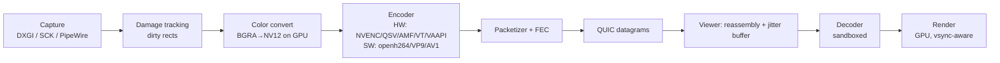

# Media Pipeline

## Key design points
- **Zero-copy GPU path** where possible: captured texture → GPU color conversion → hardware encoder, without CPU readback.
- **Low-latency encoder settings:** no B-frames, infinite GOP with intra-refresh or keyframes on demand, CBR/VBV with small buffer, `ultra-low-latency` tuning presets.
- **Congestion control:** sender-side bandwidth estimation (GCC-like, delay-gradient based) using QUIC ACK timing; adapts bitrate first, then framerate, then resolution.
- **Loss handling:** short FEC (e.g. XOR/Reed-Solomon over fragments), NACK-based retransmit if RTT < 50 ms, otherwise request intra-refresh.
- **Static content optimization:** when no damage, send nothing (0 fps idle); for text-heavy screens, prefer higher quality/lower fps (screen-content coding tools in HEVC SCC/AV1 where supported).
- **Codec negotiation** by capability: AV1 (if both have HW) > HEVC > H.264 > VP9 SW.
- **Color/quality:** 4:2:0 default; 4:4:4 option for text clarity (HEVC RExt / AV1 high profile / software).
- **Cursor** sent separately (shape + position) for responsiveness.

## Security considerations
- Decoders (especially software/FFmpeg-class) have a long CVE history. Viewer decodes in a **sandboxed child process**, restricted to shared-memory output. Hardware decoders still go through drivers — keep the attack surface minimal by constraining profiles/levels/resolutions to what the session negotiated.
- Reject streams exceeding negotiated resolution/bitrate bounds.

## Performance budget (target, 1080p60, LAN)
| Stage | Budget |
|---|---|
| Capture | 2–4 ms |
| Encode (HW) | 3–6 ms |
| Network (LAN) | 1–2 ms |
| Jitter buffer | 0–8 ms (adaptive) |
| Decode (HW) | 2–4 ms |
| Render + display | 8–16 ms (vsync) |
| **Total** | **~20–40 ms** |

## Related
[[Viewer Client]] · [[Host Agent]] · [[Testing Strategy#Performance testing]]
