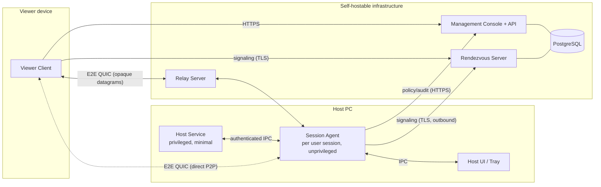
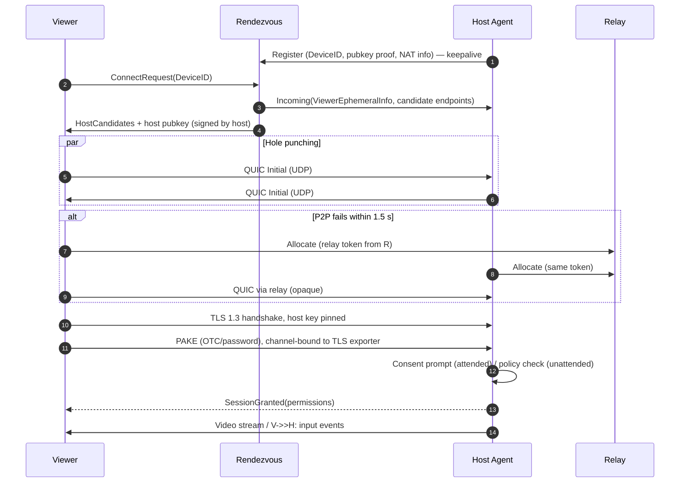

# System Architecture

## Component overview

## Components
| Component | Responsibility | Trust level | Note |
|---|---|---|---|
| Host Service | Runs as SYSTEM/root. Launches agents into user sessions, secure-desktop capture/input on Windows, auto-start, updates | **Highest privilege — smallest code** | [[Host Agent]] |
| Session Agent | Capture, encode, input injection, clipboard, file transfer, crypto session | User-level | [[Host Agent]] |
| Viewer Client | Decode, render, input capture, UI, address book | User-level | [[Viewer Client]] |
| Rendezvous Server | Presence, ID→key/endpoint lookup, hole-punch coordination, relay allocation | **Untrusted for confidentiality** | [[Rendezvous Server]] |
| Relay Server | Forward opaque encrypted datagrams when P2P fails | **Untrusted** | [[Relay Server]] |
| Management Console | Accounts, orgs, policies, audit, SSO | Trusted for *authorization* in org mode only | [[Management Console]] |

## Core design invariants
1. **Servers are not trusted with confidentiality.** Compromise of rendezvous/relay must not reveal session content or allow session takeover. → [[ADR-005 Relay Is Blind]], [[Cryptography Design]].
2. **Authentication is end-to-end.** Host decides whether to accept, based on PAKE result / signed org token / local user consent. Server can only *deny* service, not *grant* access. (Exception: org mode, where the host trusts the org's signing key — explicitly enrolled.)
3. **Privilege separation.** The SYSTEM service never parses network data. → [[Platform Hardening]].
4. **Outbound-only on the host.** No listening ports on the host by default (LAN direct mode is opt-in).
5. **Everything visible.** A session always shows an indicator on the host.

## Connection lifecycle

Details: [[Wire Protocol]], [[NAT Traversal]], [[Authentication and Authorization]].

## Deployment topology
- **Minimal self-host:** one VM running `bridge-rendezvous` + `bridge-relay` (two binaries, or one container each), SQLite. Suitable for < 1 000 devices.
- **Production:** N rendezvous nodes behind L4 load balancer (sticky by DeviceID hash), M relay nodes in multiple regions, PostgreSQL, Redis (presence cache), management console behind reverse proxy. See [[Deployment]].
