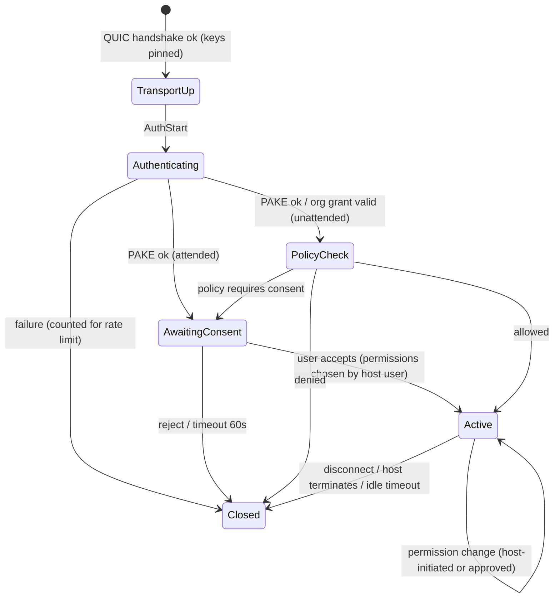

# Wire Protocol

## Layers
```
+-------------------------------------------------------------+
| Application messages (protobuf): control, input, clipboard, |
| file transfer, chat, telemetry                              |
+-------------------------------------------------------------+
| Session auth: PAKE / org grant, channel-bound (TLS exporter)|
+-------------------------------------------------------------+
| QUIC (RFC 9000) + TLS 1.3, mutual raw-public-key auth       |
|   streams: reliable ordered | datagrams (RFC 9221): media   |
+-------------------------------------------------------------+
| UDP direct  |  UDP via relay  |  TLS/TCP-443 tunnel to relay|
+-------------------------------------------------------------+
```

## QUIC usage
| Channel | QUIC primitive | Priority | Notes |
|---|---|---|---|
| Control (auth, permissions, session state) | Bidirectional stream 0 | Highest | Ordered, reliable |
| Input events | Unidirectional stream | High | Small; reliable to avoid stuck keys |
| Video | Datagrams (one encoded frame split into fragments with FEC) or per-frame unidirectional streams | High | Keyframe requests over control stream |
| Cursor shape/position | Datagrams | High | |
| Clipboard | Per-transfer stream | Medium | Size-limited |
| File transfer | Per-file stream | Low | Chunked, resumable, BLAKE3 per chunk + whole-file hash |
| Chat | Stream | Low | |

ALPN: `bridge/1`. Version negotiation in the first control message; unknown versions rejected (no downgrade below minimum supported version).

## Message framing
- Protobuf, each message prefixed with varint length; **max message size per channel** (e.g. control 64 KiB, clipboard 16 MiB configurable, file chunk 1 MiB).
- Every message type has an explicit **state machine**: messages not valid in the current state (e.g. `InputEvent` before `SessionGranted`) cause immediate session termination. This is the main defense against auth-bypass-by-message-ordering bugs.
- Unknown fields ignored, unknown message types → error (strict mode).

## Session state machine (host side)


## Permission enforcement
Permissions are enforced **on the host** at the dispatcher: each handler (input, clipboard, file, terminal) checks the current granted permission set. The viewer UI merely reflects them. Example: when `files=false`, the file-transfer stream handler is never registered for that session.

## Versioning & compatibility
- Semantic protocol version, minimum supported version raised only on security grounds (e.g. a broken auth version is hard-blocked).
- Feature flags negotiated in `Hello` (codecs, hardware decode, file transfer v2...).

## Related
[[Cryptography Design]] · [[NAT Traversal]] · [[Media Pipeline]] · [[ADR-002 QUIC End-to-End Transport]]
