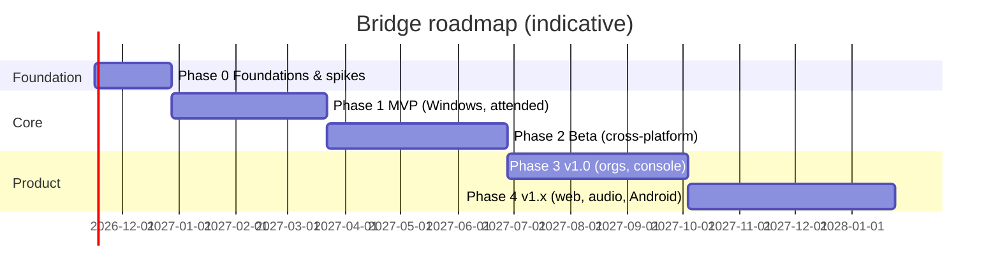

# Roadmap

Assumes the team in [[Team and Roles]] (~8–10 engineers). Durations are estimates; each phase ends with **exit criteria**, not a date.

## Phase 0 — Foundations & technical spikes (≈ 6 weeks)
**Goal:** de-risk the hardest technical questions before committing.
- Repo, CI, toolchain pinning, `cargo-deny`, signing pipeline skeleton ([[Repository Layout]], [[CI-CD and Release]]).
- Spike: DXGI capture → NVENC/QSV → QUIC datagrams → decode → render; measure latency.
- Spike: quinn hole punching through common NATs + relay fallback.
- Spike: CPace/OPAQUE crate evaluation, channel binding with rustls exporter.
- Spike: Windows service + Winlogon desktop agent spawn.
- Spike: UI framework comparison → [[ADR-004 UI Framework]].
- First version of [[Threat Model]] reviewed.

**Exit criteria:** latency < 60 ms LAN in prototype; P2P through 3 NAT types; ADR-001…005 accepted.

## Phase 1 — MVP: Windows host + Windows viewer, attended only (≈ 12 weeks)
- Host service/agent/UI split with secured IPC ([[Platform Hardening]]).
- Rendezvous + relay servers v0 (single node, SQLite), Docker images.
- Protocol v1: QUIC, pinned keys, CPace with OTC, state machine, consent dialog.
- Video (H.264 HW + openh264 fallback), adaptive bitrate, multi-monitor, input, text clipboard.
- Session indicator, disconnect, permission downgrade.
- Fuzzing harnesses for all decoders; first internal security review.
- Signed installer (MSI/MSIX), signed manual update check (TUF metadata).

**Exit criteria:** dogfooding by team for 2 weeks; 0 Critical/High internal findings; FR-01..05, FR-17 done.

## Phase 2 — Beta: cross-platform + unattended (≈ 14 weeks)
- macOS host/viewer (ScreenCaptureKit, TCC flow, notarization), Linux host/viewer (X11 + Wayland portal), Android/iOS viewer.
- Unattended access with OPAQUE password, trusted devices, rate limiting/lockouts.
- File transfer (resumable, sanitized), chat, UAC/secure desktop, reboot-reconnect.
- HEVC/AV1 negotiation, 4:4:4 mode, FEC & congestion control tuning.
- Anti-scam safeguards AS-01..04, AS-06, AS-10, AS-11.
- Auto-update with TUF, staged rollout & rollback.
- **External pentest #1 + crypto review.** Private bug bounty.

**Exit criteria:** public beta; ≥ 85 % P2P success in beta telemetry; pentest Critical/High fixed.

## Phase 3 — v1.0: organizations & management (≈ 14 weeks)
- Management console: orgs, roles, enrollment, policies, address book, audit, SIEM export.
- SSO (OIDC), 2FA (WebAuthn, TOTP), device approval, step-up auth.
- Signed org grants verified offline by hosts; two-person approval.
- Session recording, privacy screen (org-only), audit hash chain.
- Horizontal scaling: Postgres, Redis, multi-region relays, observability stack ([[Observability]]).
- Abuse ops: anomaly detection AS-07..09, abuse desk process.
- **External pentest #2** (focus console + org model), public bug bounty (funded via grants/sponsors, or hall-of-fame if unfunded).

**Exit criteria:** GA; documentation complete; incident runbooks rehearsed ([[Incident Response]]).

## Phase 4 — v1.x
- Web viewer (WebTransport + WebCodecs), audio, remote terminal, Android host, SAML/SCIM, post-quantum signatures for update root, Wayland unattended improvements.

## Related
[[Risk Register]] · [[Requirements]]
