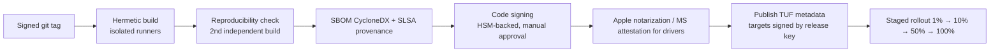

# CI/CD and Release

> [!info] Implemented (MVP)
> `ci.yml` (fmt, clippy, tests, cargo-deny, 60 s fuzzing per target) and `release.yml` (tag → binaries, SHA256SUMS, SLSA provenance attestation, draft release). TUF updates, reproducibility check and HSM signing are still planned. See [[Implementation Status#Repository & pipeline (2026-11-05)]].

## CI pipeline (every PR)
1. Format, clippy, unit tests (Win/mac/Linux runners).
2. `cargo deny`, `cargo audit`, `cargo vet`, gitleaks, CodeQL/Semgrep.
3. Fuzz smoke (60 s per target) + regression corpus.
4. Integration + network-simulation tests (Linux).
5. Build artifacts (unsigned) for review.

## Release pipeline

## Supply-chain controls
- Release builds on dedicated, ephemeral, isolated runners — **not** shared with PR builds; no secrets available to PR jobs.
- Toolchain and dependencies pinned (`Cargo.lock`, `rust-toolchain.toml`, container digests).
- Signing keys in cloud HSM / hardware tokens; signing requires 2 approvers; keys never on developer machines.
- **SLSA Level 3** target for provenance.
- Branch protection: signed commits, required reviews, CODEOWNERS on security crates.

## Update system (TUF-based)
- Roles: `root` (offline, threshold 2-of-3), `targets` (HSM), `snapshot`, `timestamp` (online, short expiry).
- Clients reject: expired metadata (freeze attack), lower versions (rollback), unsigned targets.
- Update download over HTTPS, but security does **not** rely on TLS.
- Kill switch: ability to halt rollout and revoke a target within minutes.
- Org admins can pin versions/channels (stable, beta).

## Versioning
SemVer for apps; protocol versions per [[Wire Protocol#Versioning & compatibility]].

## Related
[[Secure SDLC]] · [[Incident Response]] · [[Lessons from Prior Incidents]]
